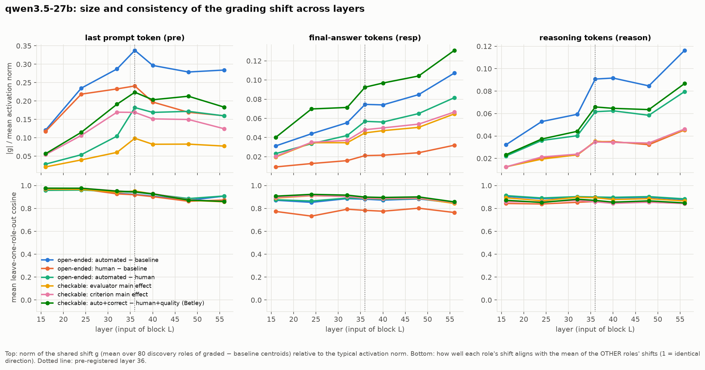
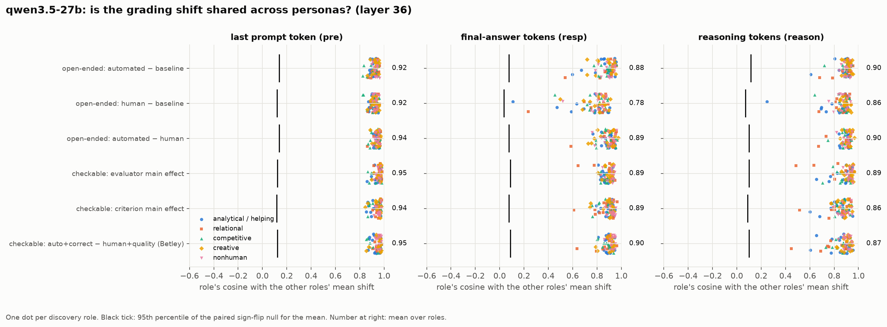
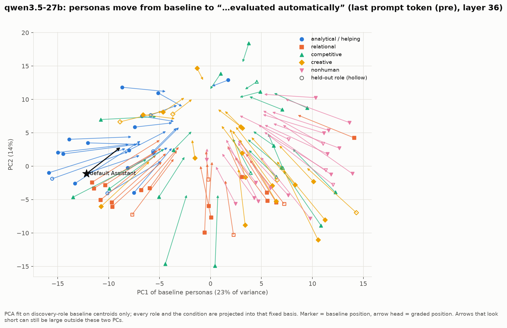
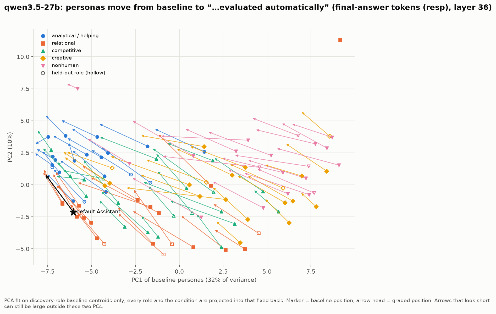
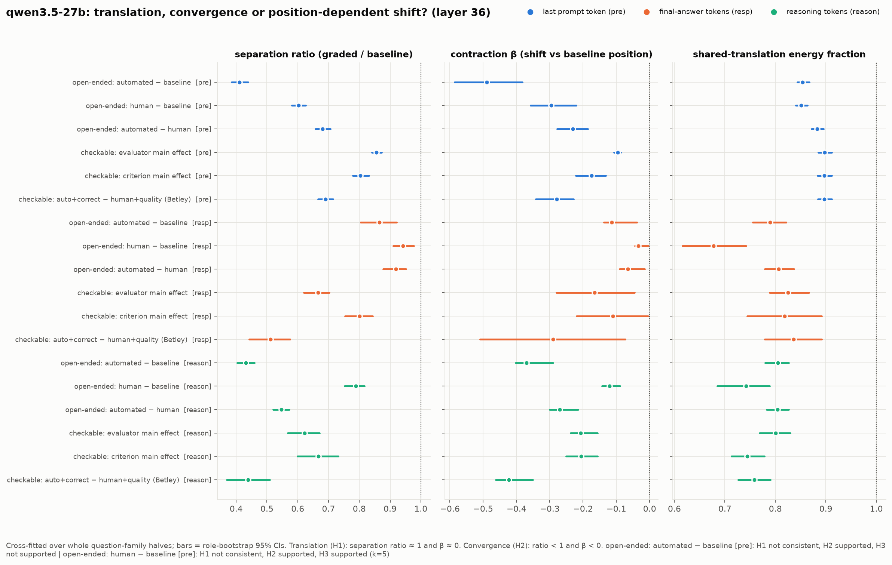
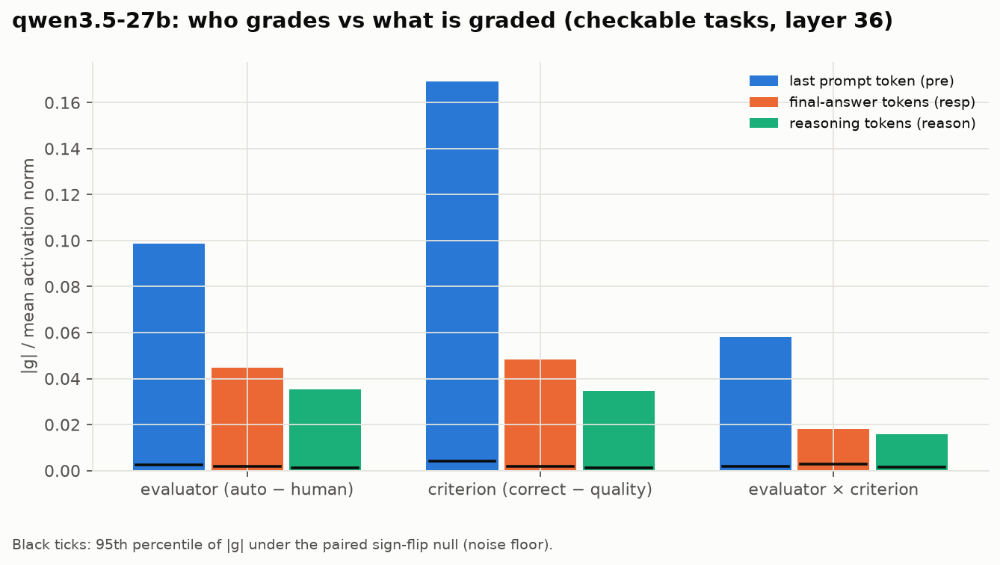
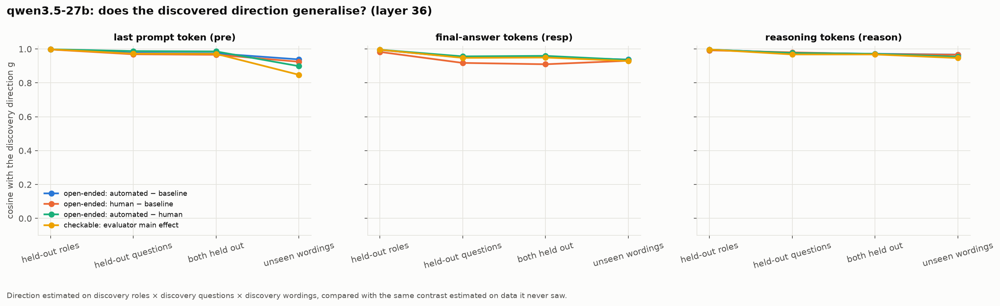
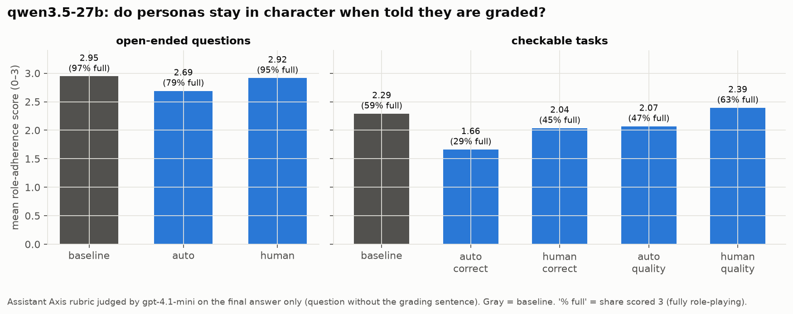
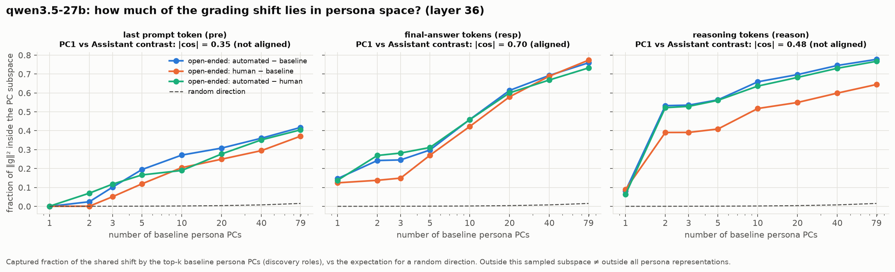

# Q1 on Qwen3.5-27B: less post-training, same pretraining

Qwen3.5-27B went through the same Q1 pipeline as Qwen3.6-27B and Qwen3.8-27B: the same
100 personas × 5 prompt variants × 60 questions, the same conditions and wordings, the same
judge and the same analysis. That is 120,240 main-grid generations plus the
wording-validation and follow-up stages (138,420 in total). Run on 2026-10-26.

**Data:** [`qwen3.5-27b/`](https://huggingface.co/datasets/timf34/grader-shifts-persona-space-outputs/tree/main/qwen3.5-27b)
on the public HF dataset. It holds raw generations, activations (layers 16–56), judge scores,
`analysis/summary.json`, vectors and figures.
**Code:** `configs/models.yaml` (`qwen3.5-27b`, revision `fc05dae`). There are no other
changes to the design.

## Why Qwen3.5

The question was what the grading shift looks like with less post-training on the same base.
No Qwen3.5/3.6/3.8 27B base checkpoint is public, so the checkpoints themselves were compared.
For the same tensors, ~4 MB slices were downloaded by HTTP range request:

| tensor | 3.5 vs 3.6 | 3.5 vs 3.8 | 3.6 vs 3.8 |
|---|---|---|---|
| embed_tokens | 0.972 | 0.933 | 0.929 |
| lm_head | 0.987 | 0.959 | 0.960 |
| layer 0 linear_attn in_proj_qkv | 0.960 | 0.894 | 0.884 |
| layer 11 self_attn q_proj | 0.954 | 0.871 | 0.860 |
| layer 36 mlp down_proj | 0.956 | 0.876 | 0.869 |
| layer 63 mlp up_proj | 0.979 | 0.916 | 0.920 |

Cosine similarity of the weights. Two independently pretrained models would give about 0.

- **Shared pretraining.** All three come from one pretraining run.
- **3.6 is close to 3.5.** It is a modest update on 3.5.
- **3.8 branched near 3.5.** It is about as far from 3.6 as from 3.5, so it likely did not
  continue from 3.6.
- **Not a clean RL control.** The gaps (relative weight difference 0.2–0.5) are larger than RL
  alone usually leaves, and 3.5 is itself heavily RL-trained. So read 3.5 → 3.6/3.8 as
  "earlier vs later post-training", not as "the effect of RLVR". The OLMo DPO → RLVR
  checkpoints ([docs/OLMO_RL.md](../../OLMO_RL.md)) are the clean RL-only comparison.
- **Same inputs.** The tokenizer is byte-identical to 3.6's. The chat template differs only
  in multi-turn history and tool-argument rendering, which this design never uses.
  Sampling is the design's own (temperature 1.0, top_p 0.95, top_k 20), not 3.5's repo
  default (0.6).

## Generations

Main grid, all roles. Answer lengths are mean answer tokens.

| | Qwen3.5 | Qwen3.6 | Qwen3.8 |
|---|---|---|---|
| truncated at 8,192 tokens | 0.44% | 0.41% | 0.00% |
| median reasoning tokens | 1,619 | 1,355 | 228 |
| median answer tokens | 272 | 250 | 401 |
| open-ended answer: baseline → "evaluated automatically" | 816 → 390 (**−52%**) | 717 → 567 (−21%) | 738 → 697 (−6%) |
| open-ended answer: baseline → "evaluated by a human" | 816 → 732 (−10%) | 717 → 718 (0%) | 738 → 805 (+9%) |
| checkable answer: baseline → auto, correctness | 300 → 105 (−65%) | 230 → 77 (−67%) | 303 → 186 (−39%) |

"Evaluated automatically" makes Qwen3.5 halve its open-ended answers. Later releases shorten
them less.

## Persona-space results (layer 36)

`g/|act|` is the norm of the shared shift relative to the mean activation norm. `sep` is
persona separation under grading relative to baseline: below 1 means personas move closer
together. All three models show a shared, stable direction (held-out-role cosine ≥ 0.98 in
every cell) and convergence (H2), not pure translation (H1).

**"Evaluated automatically" minus baseline, open-ended questions**

| representation | | Qwen3.5 | Qwen3.6 | Qwen3.8 |
|---|---|---|---|---|
| final prompt position (`pre`) | g/\|act\| | 0.338 | 0.222 | 0.288 |
| | sep | 0.41 | 0.60 | 0.55 |
| answer tokens (`resp`) | g/\|act\| | 0.075 | 0.037 | 0.025 |
| | sep | 0.87 | 0.81 | 1.14 (expansion) |
| reasoning tokens (`reason`) | g/\|act\| | 0.091 | 0.041 | 0.040 |
| | sep | 0.43 | 0.71 | 0.94 |

**"Evaluated by a human" minus baseline, open-ended questions**

| representation | | Qwen3.5 | Qwen3.6 | Qwen3.8 |
|---|---|---|---|---|
| `pre` | g/\|act\| | 0.241 | 0.170 | 0.224 |
| `resp` | g/\|act\| | 0.021 | 0.011 | 0.009 |

What this shows:
- **Bigger shift in 3.5.** It is the largest in Qwen3.5 in every representation. On answer
  and reasoning tokens, 3.6 and 3.8 show half of 3.5's shift or less (answers: 0.075 →
  0.037 → 0.025; reasoning: 0.091 → 0.041 → 0.040).
- **More convergence in 3.5.** It is strongest in Qwen3.5, especially in reasoning tokens
  (separation 0.43 → 0.71 → 0.94 across the three releases).
- **Answer length explains part of it.** Qwen3.5 also cuts its answers the most, and in the
  OLMo run the answer-token shift mostly tracked length. Some of the `resp` gap is probably
  length. That does not explain the `pre` (measured before any output) or `reason` gaps.

## The Assistant Axis

Is the top principal component of baseline persona space (discovery roles) aligned with the
default-Assistant contrast? The table shows the 95% bootstrap CI of |cos(PC1, Assistant
contrast)| at layer 36, pooled over both question groups. "aligned" means the CI is above the
pre-registered threshold.

| representation | Qwen3.5 | Qwen3.6 | Qwen3.8 |
|---|---|---|---|
| `pre` | 0.22–0.36 (not aligned) | 0.36–0.49 (not aligned) | 0.37–0.49 (not aligned) |
| `resp` | 0.59–0.74 **aligned** | 0.57–0.72 **aligned** | 0.78–0.91 **aligned** |
| `reason` | 0.17–0.50 (not aligned) | 0.48–0.64 **aligned** | 0.64–0.79 **aligned** |

The Assistant Axis gets more dominant as the main axis of persona space with later
releases. Qwen3.5 has it in its answers (about as strongly as 3.6) but not yet in its
reasoning. In 3.8 it is the clear PC1 in both. The per-role vectors and the Assistant
contrast are in `qwen3.5-27b/analysis/vectors/` on HF.

## Paired model comparison

`scripts/05_compare_models.py` was run for discovery roles × discovery questions at layer 36.
The paired bootstrap resamples the same roles and questions in both models. Raw coordinates
are never compared across models. Results are in
[`comparison_qwen3.5_vs_qwen3.6/`](https://huggingface.co/datasets/timf34/grader-shifts-persona-space-outputs/tree/main/comparison_qwen3.5_vs_qwen3.6)
and [`comparison_qwen3.5_vs_qwen3.8/`](https://huggingface.co/datasets/timf34/grader-shifts-persona-space-outputs/tree/main/comparison_qwen3.5_vs_qwen3.8)
on HF.

**Size of the shared shift (g/|act|): newer model minus Qwen3.5, mean [95% CI]**

| contrast (open-ended questions) | rep | Qwen3.6 − Qwen3.5 | Qwen3.8 − Qwen3.5 |
|---|---|---|---|
| automatically − baseline | `pre` | −0.116 [−0.125, −0.106] | −0.049 [−0.066, −0.032] |
| | `resp` | −0.039 [−0.050, −0.031] | −0.051 [−0.062, −0.041] |
| | `reason` | −0.050 [−0.055, −0.045] | −0.051 [−0.056, −0.045] |
| human − baseline | `pre` | −0.071 [−0.078, −0.063] | −0.016 [−0.029, −0.004] |
| | `resp` | −0.010 [−0.012, −0.008] | −0.012 [−0.015, −0.010] |
| automatically − human | `pre` | −0.074 [−0.079, −0.068] | −0.035 [−0.044, −0.026] |
| | `resp` | −0.030 [−0.040, −0.022] | −0.036 [−0.047, −0.028] |

**How shared the shift is across personas (mean leave-one-role-out cosine): newer − Qwen3.5**

| contrast | rep | Qwen3.6 − Qwen3.5 | Qwen3.8 − Qwen3.5 |
|---|---|---|---|
| automatically − baseline | `pre` | +0.013 [+0.009, +0.017] | −0.004 [−0.011, +0.002] |
| | `resp` | −0.053 [−0.079, −0.033] | −0.075 [−0.124, −0.037] |
| | `reason` | −0.015 [−0.031, 0.000] | −0.034 [−0.067, −0.011] |
| human − baseline | `resp` | −0.172 [−0.229, −0.124] | −0.220 [−0.282, −0.160] |
| | `reason` | −0.084 [−0.118, −0.051] | −0.161 [−0.216, −0.116] |

**Persona geometry across models (no coordinate alignment)**

| | rep | 3.5 vs 3.6 | 3.5 vs 3.8 |
|---|---|---|---|
| RSA of baseline persona distances | `pre` | 0.96 | 0.87 |
| | `resp` | 0.95 | 0.90 |
| | `reason` | 0.83 | 0.79 |
| correlation of per-role shift directions (auto − baseline) | `pre` | 0.93 | 0.85 |
| | `resp` | 0.66 | 0.48 |
| | `reason` | 0.63 | 0.60 |

What this shows:
- **The shift is reliably largest in Qwen3.5.** This holds for every contrast and
  representation; no CI crosses zero. In the prompt representation (`pre`), 3.6 has the
  smallest shift and 3.8 sits between, so the order there does not follow release order.
- **Newer models' shifts are more persona-specific.** On answer and reasoning tokens, the
  grading shift is less shared across personas in 3.6 and 3.8 than in 3.5. The gap is
  largest for "evaluated by a human". So later post-training makes the response to grading
  depend more on which persona is speaking.
- **The persona landscape is largely kept.** Baseline persona distances correlate
  0.87–0.96 across models in `pre` and `resp`. They correlate less in reasoning
  (0.79–0.83), which is also where the Assistant Axis emerges between 3.5 and 3.6.
- **Per-role shifts transfer at the prompt but not in the outputs.** Which roles move
  together under grading is very similar at the prompt (0.85–0.93) but much less so in
  answers and reasoning (0.48–0.66).

The comparison script's own caveat applies too. A difference between releases is
established, but attributing it to RLVR would need training information or controlled
checkpoints (see "Why Qwen3.5" above).

## Figures

Generated by `scripts/make_figures.py --model qwen3.5-27b` (same figures as the 3.8 report).

| | |
|---|---|
|  |  |
|  |  |
|  |  |
|  |  |
|  | |

## Reproduce

Pods: 4 × 1 H200, `SHARDS=4`, 8.4–9.3 h each. The container disk must be 200 GB; see the
README.

```bash
rp up --name gs-q35-s0 --gpu h200 --gpus 1 --volume none --volume-size 100 --disk 200
rp bootstrap gs-q35-s0 --repo https://github.com/timf34/grader-shifts-persona-space --env .env --req requirements/pod.txt
rp run gs-q35-s0 --job q1 --env SHARD=0 --env SHARDS=4 --env SHUTDOWN=stop -- bash scripts/pod/run_q1.sh qwen3.5-27b
# laptop: download, then 04_analyze.py in 21 (rep, layer) parts under memguard, then merge
python -u scripts/download_outputs.py --model qwen3.5-27b --what all
python -u scripts/04_analyze.py --model qwen3.5-27b --reps pre --layers 36 --out-dir outputs/qwen3.5-27b/analysis_parts/pre_L36   # ... x21
python scripts/merge_analysis.py --model qwen3.5-27b --parts outputs/qwen3.5-27b/analysis_parts/*
python scripts/make_figures.py --model qwen3.5-27b
python -u scripts/05_compare_models.py --a qwen3.5-27b --b qwen3.6-27b --out-dir outputs/comparison_qwen3.5_vs_qwen3.6
```
